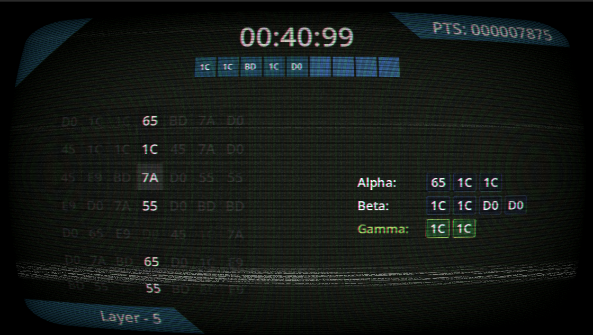
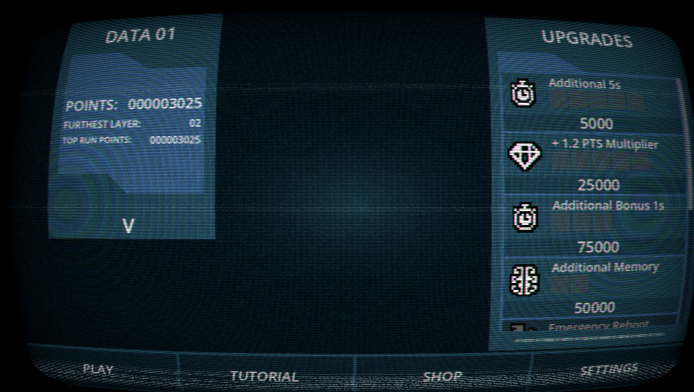

# Data Hack: Time Attack

A fast-paced cyberpunk puzzle roguelite inspired by the "Breach Protocol" minigame. Infiltrate network layers, solve matrix paths under time pressure, and purchase system upgrades to breach deeper into layers.

## Play it in Browser
[Play it on my Itch.io here](https://martisos.itch.io/data-hack)

## Quick Start
* **Mouse Click:** Select tokens from the code matrix
* **Phase 1 (Row):** Every layer always starts on the **TOP ROW**
* **Phase 2 (Column):** Picking a token locks your next move to its **VERTICAL COLUMN** (Row -> Column -> Row...)
* **Upload Injections:** Match the target sequences to earn bonus time and score points
* **Upgrade:** Spend your points in the Shop to increase time, RAM buffer, and score multipliers

## Features
* **Time-Attack Survival:** The timer counts down. Successfully uploading Injections gives you time to stay connected.
* **100% Solvable Boards (Golden Path):** Levels are reverse-engineered from a winning path, guaranteeing that every single puzzle has a winning solution.
* **Harder Layers:** Deeper layers introduce dynamic difficulty modifiers.
* **Roguelite Meta-Progression:** Upgrade shop featuring extra starting time, reward boosters, score multipliers.
* **Retro-Terminal Aesthetics:** VHS curved screen shader, responsive audio.

## Credits
* **Inspiration:** Hacking mechanics inspired by *Cyberpunk 2077* (Breach Protocol)
* **Engine:** Built with [Godot Engine](https://godotengine.org/)

## Music
* **oga_japanesehack_battle_of_the_clocl_overwhelming_darkness_mix.ogg** (License: **CC-BY-SA 4.0**) — Mix of:
  * *Oga japanese hack* by ISAo (OGA-BY 3.0) — https://opengameart.org/content/japanese-samurai-ninja-battle-trailer
  * *Battle of the clock* by Technodono (CC-BY-SA 4.0) — https://opengameart.org/content/battle-of-the-clock
  * *overwhelming_darkness* by Technodono (CC-BY-SA 4.0) — https://opengameart.org/content/overwhelming-darkness

## How to run locally
* Download [Godot Engine (4.x)](https://godotengine.org/)
* Clone or download this repository
* Open the project folder in Godot Editor
* Press **F5** to run the game!